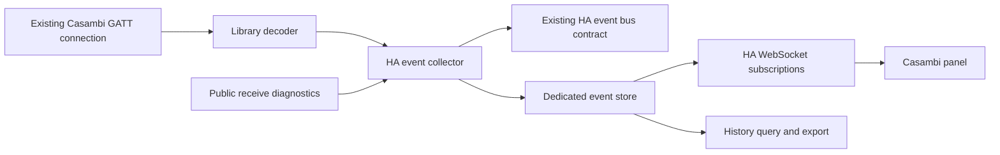

# Network events viewer in Home Assistant

Implementation contract, 2026-10-22. The embedded panel, archive, authenticated
stream and export are implemented in this source tree. They have been exercised
with Home Assistant 2026.10.2 in an isolated runtime and installed on the household
HA instance. Live startup, GATT reception, archive saving, filter options and an
event deep link surviving an HA restart were checked there.

## Outcome

Add one **Casambi** page to the HA sidebar. An administrator can open it in a
desktop browser or the HA Companion app, choose a configured network, and inspect
received events as they arrive. The integration collects events independently of
open viewers. Saved history remains available after navigation, BLE reconnects,
config-entry reloads and HA restarts.

The panel uses the integration's existing authenticated Casambi connection and
HA's authenticated WebSocket connection. It does not start another BLE client or
depend on the Mac demo server. The viewer exposes observation and export, while
node changes remain in the existing Reconfigure flow.

## Existing boundaries

| Owner | Current behavior | Design consequence |
| --- | --- | --- |
| `CasambiBt._network_events.NetworkEventDecoder` | Decodes fixture-profile state observations and received type 7 frames. Equal state values are suppressed; type 7 observations bypass legacy switch pairing. | Keep one decoder. Do not parse protocol bytes again in HA or JavaScript. |
| `CasambiApi._network_event_handler` | Publishes `casambi_bt_network_event`, including `entry_id`, to the HA bus. | Add a collector at this boundary and preserve the current bus contract. |
| `Casambi.registerReceiveDiagnosticHandler` and `connectionInfo` | Expose safe receive metadata and the authenticated connection target. | HA uses the public facade; private client fields stay inside the library. |
| Mac demo | Has its own HTTP server, JSONL files, bounded live buffers and handwritten DOM updates. | Reuse behavior requirements and decoder contracts, rather than embedding its server or file-storage implementation. |
| HA runtime | `hass.data[DOMAIN]` currently maps config-entry IDs to `CasambiApi`. | Keep that mapping. Give the viewer one separate, integration-wide runtime owner. |

An observation is something received by this GATT client. It does not establish
that every mesh message or every physical button action was received. A continuous
GATT packet sequence is evidence about the node-to-client connection, not proof
of complete wireless-switch or mesh delivery.

## Interface

### Entry and navigation

- Register a custom panel at `/casambi-events` with sidebar title **Casambi**.
- A network selector lists configured entries; a single network is selected
  automatically. The route preserves the selected entry and event when linking
  directly to an observation.
- Follow HA fonts, theme colors, light/dark mode, language and mobile navigation.
  Ship a standard JavaScript custom element with the integration. No separate
  frontend installation, CDN or framework migration is required.
- Keep capture running when the panel is closed. Multiple viewers share the
  same collector, store and GATT connection.

### Layout

| Region | Desktop | Phone / narrow panel |
| --- | --- | --- |
| Header | Network, selected/verified connection node, connection status, pause and export | Network and status; compact pause/export controls |
| Filters | Search, device, event type, source; expandable time range | Search and expandable inline filters with an active-filter count |
| Event list | Time, device, event, value and source columns | Two-line rows with time, device, event/value and source |
| Event details | Persistent inspector beside the list | Detail page with Back returning to the same list position |
| Receive diagnostics | Expandable status section | Same section beneath the compact status line |

Use the list as the main surface. Avoid summary cards that push the event stream
below the fold. Device values use their actual units; timestamps include
milliseconds and follow the user's HA locale/time-zone settings. The saved time
is the HA receive time, not an invented device timestamp.

Selecting an event opens structured fields first, followed by a JSON view of the
same approved record. Type 7 details expose ButtonEvent/NotifyInput indices,
opcode, origin and target, counters, flags, optional handle, age and packet
sequence. Unknown meanings remain explicitly unknown. Missing values stay null,
distinct from received zeroes. Only the interpreted input bytes are shown as hex.

The `Unit #N` control opens its current HA device page. Selecting the event row
also lists that device and its registered entities in the inspector. An enabled
entity opens HA's native more-info dialog; disabled entities are identified and
remain visible without an active more-info control. Registry lookup uses the
current unit UUID and owning config-entry ID, never an event name or entity-ID
guess. These current HA associations are fetched on selection, not persisted in
the historical observation. An unloaded network or missing device is explicit.

Switch rows show the switch name, `Unit #30`, and an action such as **第 1 键 · 按下**.
The `unit_id` identifies the associated switch, independently of `origin_unit_id`
on a forwarded frame. Button labels preserve the existing four-button display
convention: raw indices `1/2/3/0` display as buttons `1/2/3/4`. This is a
capture-derived compatibility convention, not a universal physical layout.
`button_index` and `button_label_basis` retain that distinction; other indices
display as raw input indices. Unknown action codes do not become guessed presses.

### Behavior while events arrive

- Start in **Follow latest** mode, with newest observations first. Scrolling into
  history stops following. A **New events (N)** control returns to the head.
- **Pause display** freezes the presented list, not capture or persistence.
  Resuming queries all intervening saved observations, in pages if necessary.
- Keep selected event, inspector section, filters, focus and scroll anchor
  separate from incoming data. New events, status updates and reconnects must not
  recreate the list or close the inspector.
- HA can set the `hass` property whenever unrelated entity state changes. Update
  that reference without rebuilding the component or subscribing again. A new
  observation subscription is needed only for a changed connection, network or
  filter generation.
- Use stable event IDs and a virtual list. The rendered DOM and resident page
  cache can be bounded; the underlying archive and searchable history are not
  limited by those bounds. An inspected event remains pinned in view state even
  when its list page is evicted.
- Search/filter the complete stored history on the server. Do not search only
  the last loaded window. Changing filters creates a new query generation;
  responses from a previous generation cannot replace current results.
- Show **Saved observations**, **Loaded matches**, and **New events** with their
  respective scopes. Never present a rendering window as a capture limit.
- There is no destructive clear button in the event toolbar. **Show from now**
  changes this viewer's start cursor and leaves saved history intact.

## Ownership and data flow

Create one `NetworkEventsManager` under `hass.data[DATA_NETWORK_EVENTS]`, separate
from `hass.data[DOMAIN]`. It owns network attachment, the store, status and
subscription wakeups. Each `CasambiApi` attaches exactly once before connecting
so initial observations are collected, and detaches on unload. A manager survives
config-entry reloads, so neither history identity nor subscribers are reset by
changing the GATT node.

Keep `casambi_bt_network_event` and `casambi_bt_switch_event` behavior compatible.
Feed the viewer collector directly from the owning callbacks; do not subscribe
to the bus and feed the same event back into it. The current bus is a live API,
not the viewer's durable replay source. Existing bus delivery stays independent
of archive availability; only the viewer's saved-record stream waits for commit.

Expose `registerReceiveDiagnosticHandler` / `unregisterReceiveDiagnosticHandler`
through `Casambi`. Forward the client's existing metadata contract and provide
safe connection metadata for the authenticated session. HA must not construct
`CasambiClient` directly or read its private fields as the demo does.

The header can always show the configured GATT target. Show an actual unit ID
only when the connection reported it. The network address is not a fixed unit.
Likewise, the strongest scanner's RSSI is not evidence of the receiver currently
carrying the connection. Any available receiver information must come from HA's
public connection metadata. Candidate reception uses GATT-capable scanners,
irrespective of brand or scanning mode.

## Event store and record contract

Use a dedicated SQLite database at
`<config>/.storage/casambi_bt_events/events.sqlite3`. This is separate from the
existing credential/cache directory. Use standard-library `sqlite3` in a dedicated
writer executor; perform reads in short independent read transactions. Database
work never runs in the BLE callback or HA event loop. Export reads bounded pages
and writes each approved record to the HTTP stream.
Enable SQLite WAL mode and full commit synchronization. HA begins its own archive
when this collector starts; an earlier Mac capture is a separate data source.

The initial schema has:

- `meta`: a persistent random `store_id`; `PRAGMA user_version` holds the schema version.
- `events`: monotonic sequence, entry ID, BLE connection-session ID, receive time,
  unit, type, source, source stream, decoder version and approved event JSON.
- `sessions`: connection target and start/end; reported unit/protocol metadata
  remains in session-scoped connection diagnostics.
- `receive_diagnostics`: session-scoped receive, verification and decoder-decision
  metadata. These records do not inflate the displayed observation count.
- `runs` and `gaps`: clean/unclean capture-run boundaries and recorded losses.

Index event queries by `(entry_id, sequence)`, `(entry_id, receive_time)` and the
actual device/type/source filter paths. Use parameterized queries and keyset
pagination rather than offset pagination. Preserve names as observed when the
event was received; renaming a device must not rewrite earlier observations.

`event_id = store_id + sequence` identifies a saved observation. A BLE reconnect
starts a new connection-session ID but does not restart the event sequence.
Store replacement changes `store_id` and produces an explicit reset condition.
The decoder's Boolean `session` flag remains a protocol field and must not be
confused with either identity.

The collector copies fields through a versioned allowlist. Keep decoded values,
control metadata and known invocation/receive metadata. Do not serialize a config
entry, network JSON, arbitrary exception text, unparsed payload, whole state
buffer or the legacy API's raw/decrypted packets into the new database or UI.
Unknown opcodes remain visible through header metadata and payload length;
malformed frames remain explicit diagnostic observations.

Persist records before announcing them as saved or publishing them to viewer
subscribers. One writer batches commits with a normal target of at most 50 ms;
every successfully committed observation receives one stable ID. This ID prevents
duplicate delivery from creating duplicate rows. It must not suppress separate
received protocol retransmissions or merge ButtonEvent with NotifyInput.

History has no automatic row-count or age cutoff. Pagination, virtualization and
export batching are delivery mechanisms, not retention limits. Removing a config
entry detaches its live collector but does not silently purge its diagnostic
archive. The manager retains archived network metadata so the panel can identify
that history while the integration is loaded. Deliberate archive deletion is a
separate maintenance operation, outside this viewer's read/export controls.

On HA shutdown, drain accepted records within a finite timeout and close the
writer. Mark capture runs open/closed durably so an interrupted run is shown as
an interval whose completeness is unknown after restart.

## WebSocket and export API

Register commands once in integration setup. Use HA's existing connection and
server-side administrator checks, consistent with its diagnostic event surface.
Validate entry IDs, record ownership and filter schemas on the server. Static
frontend assets contain no network data or credentials.

| Command | Contract |
| --- | --- |
| `casambi_bt/events/networks` | Configured/archived network metadata, connection/storage status and scoped counts |
| `casambi_bt/events/subscribe` | Subscribe for one entry, filter, `events`/`status_only` mode and optional `(store_id, after_sequence)`; return snapshot/catch-up/live messages and status |
| `casambi_bt/events/ack` | Acknowledge the one outstanding page on this connection's subscription, after the client has processed it |
| `casambi_bt/events/query` | Query older matching events using a before cursor and fixed high-water mark; return a page, next cursor and `has_more` |
| `casambi_bt/events/get` | Retrieve one selected event by ID and entry, including when its list page is no longer resident |
| `casambi_bt/events/unit` | Resolve the current unit UUID to the owning entry's HA device and entity registry records |

Use pages of 250 observations initially. No page-size value imposes a total
history or replay cap. Every stream envelope includes `schema_version`,
`store_id`, `entry_id`, `subscription_generation`, `scanned_to_sequence`, and
phase. A cursor advances across scanned nonmatching observations as well as
matching rows; otherwise a quiet filter would repeatedly replay the same range.

The subscription owns a database cursor, not an unbounded per-browser event
queue. Register its wakeup before choosing the initial high-water mark. With no
resume cursor, send the latest matching page plus a cursor for loading older
history. With a valid resume cursor, send all missing matching rows in bounded
pages, then enter live mode. Query only committed rows. Clear a wakeup before
reading the next watermark so commits during a read cannot be lost between
replay and live delivery.

Allow one outstanding data page per subscriber. Wait for its acknowledgement
before reading another page; validate acknowledgement ownership, generation and
cursor against the page actually sent. Use a finite 15-second acknowledgement
timeout, cancel the subscriber on expiry, and resume from the client's last
processed cursor when it returns. This bounds a slow browser's outstanding data
without limiting saved history. Coalesce status changes while a page is pending.
During Pause display, use a status-only subscription and retain the display
cursor; resume the observation stream from that cursor. No paused-event RAM
backlog is needed in the browser.

The frontend uses `hass.connection.subscribeMessage` with automatic replay of
the old subscription message disabled. After HA reconnects, subscribe again with
the latest processed cursor and current filters. Dispose old subscriptions and
connection listeners on network changes or panel removal. Keep view state during
transport reconnection. A mismatched store ID, invalid cursor or capture gap gets
an explicit message instead of an unexplained empty list.

Export uses an administrator-only authenticated HTTP view under
`/api/casambi_bt/events/export`. The panel uses HA's `callApiRaw` authenticated
client. Freeze an upper sequence watermark at export start and stream approved
JSONL records for the requested network/filter/range, including records outside
the browser's resident pages. A manifest records schema/decoder versions and
known capture gaps. Each event carries its decoder version. Write a typed header record, followed by event records
and a completion record containing the written count and final cursor. A missing
completion record means the export is incomplete. Cancellation closes database
readers. Large-download behavior must be verified in desktop browsers and the
Companion app rather than inferred from server streaming.

## Failure and status behavior

| Condition | Behavior |
| --- | --- |
| HA WebSocket disconnected | Preserve the current view, show reconnecting, and resume from the last processed cursor. Server-side capture continues. |
| BLE disconnected or entry reloading | Show the actual network state and session boundary. History remains readable; the viewer does not initiate another connection. |
| Pause or reading history | Capture and persistence continue. Keep the reading position and inspector; offer return to latest. |
| Filter has no matches | Show no matching observations, with the active filter visible. Do not imply no network activity. |
| No observations yet | Show waiting only when the connection and collector are healthy. Otherwise show the failing stage. |
| Unknown/malformed input | Preserve the available metadata, nulls and explicit decode status; do not invent an action or silently discard the row. |
| Store unavailable, write failure or collector overload | Show capture/storage failure, last durable cursor/time and a known/unknown gap. Do not label unsaved records as saved, drop old rows silently, or fall back to a fake empty archive. Lighting control continues through its existing owner. |
| Slow browser | Keep its cursor in the database-backed subscription and replay in pages. Do not accumulate all missed rows in a per-client RAM queue. |

The ingress queue needs a documented finite memory budget. Saturation is a
capture failure with an explicit gap, not a normal retention policy. Retry only
identified recoverable database failures with finite waits. Unexpected failures
propagate to the manager's supervised writer boundary and become visible status;
they must not turn into empty results or reset the BLE connection. Persist gap
information when storage recovers; after an interrupted process, mark the
unclean interval as unknown rather than inventing an exact loss count.

The ingress budget is 8,192 records. Commits gather for 25 ms and contain at most
256 ingress records, plus any outstanding gap metadata. Expected write failures
get three attempts with 1- and 2-second waits. Shutdown allows 10 seconds to drain.
An unavailable archive at startup reports an unknown saved count and rejects
history reads; BLE control can still load. Fix the storage problem and restart HA
to reopen it. No replacement empty database is used as recovery.

Receive diagnostics show received packet/type 7 counts, signature failures,
processing errors, and legacy copy/pairing decisions for the selected session.
These counters are separate from event counts. They do not claim a count of
physical clicks or prove where an unobserved press disappeared.

## File ownership and implementation order

| Change | Responsibility |
| --- | --- |
| Library `_casambi.py`, public diagnostic/connection types and focused tests | Publish the existing safe receive metadata and session identity through the normal client boundary |
| HA `network_events.py` | Collector manager, network attachment, status and approved record projection |
| HA `event_store.py` | SQLite schema, one writer, cursor queries, restart/gap handling and streamed export reads |
| HA `websocket_api.py` | Authenticated commands, cursor/filter validation and subscription cleanup |
| HA `frontend.py` and `http.py` | Custom panel/static registration and authenticated export |
| HA `frontend/casambi-events.js`, `viewer-model.js`, `event-list.js`, `translations.js` | HA custom element, independent view state, paged virtual list, inspector and English/German/Chinese localization |
| HA `__init__.py`, `const.py`, `manifest.json` | Initialize one runtime, attach/detach callbacks and declare the panel/WebSocket dependencies |
| Existing Mac demo | Remains a local diagnostic tool; no production dependency on it |

Implement the backend record contract and replay behavior first, then the panel
and history controls, followed by integration lifecycle and real HA validation.
Ship the frontend assets inside the integration package. Asset URLs include the
integration version so frontend cache reuse cannot mix incompatible API schemas.

## Observable completion and validation

1. Existing event parsing and switch automations retain their current behavior.
   Known ButtonEvent and NotifyInput fixtures remain separate observations;
   unknown payload bytes do not enter the viewer record contract.
2. Opening two viewers does not create a second BLE connection or double the
   stored observations. Reloading the entry does not multiply callbacks.
3. A focused real-HA test covers panel registration, command authentication,
   subscribe/unsubscribe, entry unload/reload and stored history after restart.
   Existing AST-isolated tests alone do not establish this integration behavior.
4. A history-to-live interleaving test proves no missing/duplicate saved IDs when
   a commit occurs during subscription setup. Filtered streams advance their
   cursors even when no events match. Reconnect resumes from the current cursor.
   A stalled client keeps at most one data page in flight, and expired or repeated
   acknowledgements cannot skip records or advance another subscriber's cursor.
5. Inject more than 10,000 observations. The earliest records remain searchable
   and exportable, while the rendered DOM stays bounded. Pause/resume and filter
   changes do not discard intervening saved observations.
6. Keep an inspector open and the list scrolled while new events arrive, the
   filter changes, and HA reconnects. Preserve selection/focus and the applicable
   reading anchor. Test desktop and narrow/Companion layouts, light/dark themes,
   keyboard navigation and restoration from event details.
7. Exercise store/write/ingress failures. The UI must show a failure or gap and
   never claim complete saved history. Lighting control must remain independent.
8. On the real network, observe wired and battery-switch source streams and
   connection-session changes. Compare received observations, not assumed
   physical click counts. Normal receive-to-display latency targets under 500 ms;
   measure it with a controlled fixture before making a performance claim.

## Local validation and installation

The integration requires the matching `casambi-bt-revamped==0.4.2` library.
The integration build is `1.9.1`. Install both builds together through the
normal package/integration installation path, then restart HA so global panel and
WebSocket registration runs. Administrator accounts will see **Casambi** in the
sidebar at `/casambi-events`. Existing entries collect automatically; node
selection stays in the integration's Reconfigure flow. No Mac server is needed.

The focused runtime suite in `tests/test_event_viewer.py` uses real HA setup,
WebSocket/HTTP handlers and temporary SQLite files with synthetic networks. Only
the radio is mocked in its full integration lifecycle test. It covers durable
restart identity, 10,100-record history, snapshot/commit races, raw report copies,
ACK ownership/expiry, complete export, administrator permissions, entry reload,
write failure, queue overflow and startup storage failure.

`node --test tests/frontend/test_viewer_model.mjs` checks independent view state.
For manual layout checks, run `python tests/frontend/serve.py` in an environment
with `aiohttp`, then open `http://127.0.0.1:8887`. Its banner and data are explicitly
synthetic. The actual production custom element is used; no radio or credential
source is accessed. Desktop/narrow layout, themes, pause/resume, a 10,000-event
burst, inspector expansion, filtering and reconnect were checked there.
Add `?language=de` to inspect the German UI. The panel follows HA's user language;
`de`, `de-DE`, `de-AT` and `de-CH` use German. Chinese locales use Simplified
Chinese, and other unsupported languages use English. Device names and raw
protocol identifiers remain unchanged.

The real Mac demo was checked separately for preserved historical button labels
and its active GATT/WebSocket connection. On the household HA instance, the panel
received and saved real device-state observations; its GATT session and a
previously saved event remained available after restart. A controlled physical
switch press, Companion-app downloads and receive-to-display latency were not
measured during installation.

## Verified HA interfaces

- [Custom panel contract](https://contributors.home-assistant.io/frontend/custom-ui/panel/)
  and [HA 2026.10.2 registration API](https://github.com/home-assistant/core/blob/2026.10.2/homeassistant/components/panel_custom/__init__.py).
- [HA 2026.10.2 WebSocket commands](https://github.com/home-assistant/core/blob/2026.10.2/homeassistant/components/websocket_api/commands.py)
  and [administrator decorator](https://github.com/home-assistant/core/blob/2026.10.2/homeassistant/components/websocket_api/decorators.py).
- [HA JavaScript WebSocket client](https://github.com/home-assistant/home-assistant-js-websocket/blob/master/README.md),
  including `subscribeMessage` and its `resubscribe` option. The installed
  `home-assistant-frontend==20260930.4` bundles also use
  `connection.subscribeMessage(callback, message, {resubscribe: false})`.
- [Frontend 20260930.4 API types](https://github.com/home-assistant/frontend/blob/20260930.4/src/types.ts),
  including panel properties, `hass.connection` and `callApiRaw`.
- [HA 2026.10.2 static-path registration](https://github.com/home-assistant/core/blob/2026.10.2/homeassistant/components/http/server.py).
